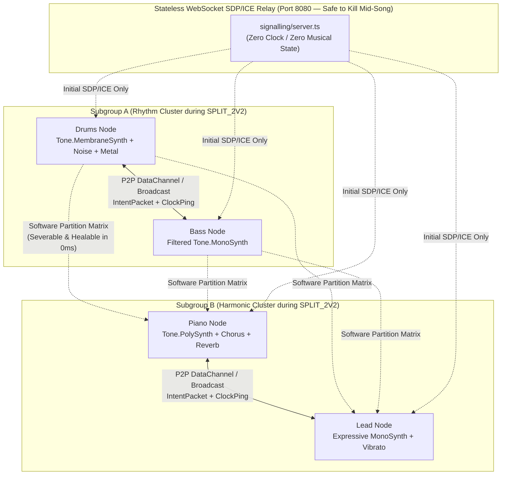
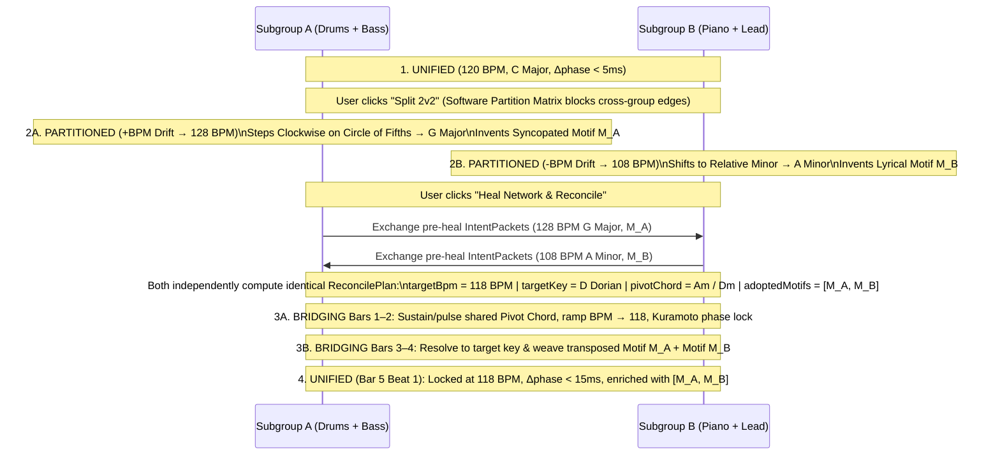

# Symphony Without a Conductor

**A Decentralized, Fault-Tolerant P2P Autonomous Orchestra with Deterministic Mathematical Partition Reconciliation**

`Symphony Without a Conductor` is a real-time distributed systems + generative music observatory where four autonomous browser nodes (**Drums**, **Bass**, **Piano**, **Lead**) perform together over peer-to-peer WebRTC `RTCDataChannel`s (or local `BroadcastChannel`) with **zero central conductor**, **zero server-side clock**, and **zero server-side musical state**.

When a network partition splits the orchestra into isolated subgroups, neither side stops playing: each subgroup autonomously diverges along music-theory guardrails (drifting in tempo, modulating around the Circle of Fifths, and inventing new isolation motifs). When the partition heals, neither subgroup overwrites the other—instead, every node independently computes the **exact same `ReconcilePlan`** from exchanged `IntentPacket`s and executes a **4-Bar Creative Reconciliation Bridge** through a shared Circle-of-Fifths **Pivot Chord** while phase-locking Beat 1 to within `<15ms`.

---

## 1. Core Architectural Invariants

1. **Zero React State or Timers in the Audio Loop:**
   - Synthesis scheduling runs exclusively inside `Tone.Transport.scheduleRepeat(..., "16n")` in [`OrchestraEngine.ts`](./web/src/engine/OrchestraEngine.ts), reading directly from a plain mutable state reference (`stateRef.current`).
   - React components in [`web/src/components/`](./web/src/components/) only subscribe to throttled engine snapshots (`onSnapshot`) and P2P packet pulses (`onPacketEdgePulse`) for visual rendering.
2. **Signalling Server Fault Tolerance:**
   - [`signalling/server.ts`](./signalling/server.ts) is strictly a stateless WebSocket SDP/ICE relay for initial WebRTC handshake discovery.
   - Killing `signalling/server.ts` (`Ctrl+C`) mid-performance has **zero effect** on active peers: the UI header badge switches to `SIGNALLING: OFFLINE — P2P AUTONOMOUS` while WebRTC `RTCDataChannel`s continue exchanging `IntentPacket`s, `ClockPing`s, and `PartitionCommand`s without dropping a single beat.
3. **Deterministic Mathematical Reconciliation:**
   - Reconnecting subgroups never use last-write-wins or master-slave overwrite.
   - [`reconciliation.ts`](./web/src/math/reconciliation.ts) and [`circleOfFifths.ts`](./web/src/math/circleOfFifths.ts) guarantee that for any permutation of arriving `IntentPacket`s ($4! = 24$ arrival orders and all $1,296$ key/mode combinations), every peer independently computes the **exact same `ReconcilePlan`**:
     - Symmetric `targetBpm` across partition subgroups
     - Commutative Circle-of-Fifths midpoint `(targetKeyRoot, targetMode)`
     - Shared diatonic or suspended dominant `pivotChord`
     - Deduplicated, canonically ordered `adoptedMotifs` invented during isolation

---

## 2. System Architecture & Reconciliation Diagrams

### A. Full-Mesh P2P DataChannel & Software Partition Matrix Topology



### B. NTP Lowest-RTT Clock Offset + Kuramoto Beat-1 Phase Locking

```text
Peer A (t1) ─────── CLOCK_PING (t1) ────────► Peer B (receives at t2)
                                              Peer B (transmits at t3)
Peer A (t4) ◄────── CLOCK_PONG (t1,t2,t3) ───┘

  RTT    = (t4 - t1) - (t3 - t2)
  Offset = ((t2 - t1) + (t3 - t4)) / 2   (Filtered via Top-K lowest-RTT median)

Decentralized Kuramoto Phase Coupling on [0.0 .. 4.0) Beat Ring:
  Δφ = (K / N) * Σ (4 / 2π) * sin( 2π * (φ_peer - φ_local) / 4 )
  ──► Pulls all reachable oscillators into < 15ms Beat-1 alignment without a master clock.
```

### C. 4-Bar Creative Reconciliation Bridge (`UNIFIED → PARTITIONED → BRIDGING → UNIFIED`)



---

## 3. Quickstart & Commands

### Prerequisites
- Node.js `>= 20` and `npm`

### Install & Run
```bash
# Install dependencies across root, signalling, and web workspaces
npm install

# Start both the stateless WebSocket signalling server (:8080) and Vite web app (:5173)
npm run dev
```

### Verification Commands
```bash
# Run strict TypeScript typecheck across shared, signalling, and web
npm run typecheck

# Run all 8 Vitest unit & integration test suites (37 tests)
npm test

# Build production web bundle
npm run build
```

---

## 4. Step-by-Step Live Demo Playbooks for Judges

### Playbook 1: 1-Tab Projector Observatory Demo (Zero-Config, Recommended for Stage Presentation)
1. Run `npm run dev` (or `npm run dev:web` — single-tab mode works 100% offline via `BroadcastChannel`).
2. Open **`http://localhost:5173`** in Chrome/Edge/Safari.
3. Verify **`Auto-Spawn Companion Peers: ON`** and **`Observatory Mix (All Peers)`** are active in the top header.
4. Click the green **`Join Orchestra & Start Audio`** button.
5. Click **`Guided 90s Auto-Demo`** in the bottom control bar (or manually click **`Split 2v2`** $\rightarrow$ wait 2–4 bars to hear and watch the two subgroups diverge on the **Beat-Phase Alignment Radar** and **Circle-of-Fifths Harmonic Radar** $\rightarrow$ click **`Heal Network & Reconcile (4-Bar Bridge)`**).
6. Watch the golden **Pivot Chord Bridge** arc appear on the topology graph, the 4 orbital dots converge onto Beat 1 (`<15ms LOCK`), and the **Motif Provenance Cards** transition from `INVENTED IN ISOLATION` $\rightarrow$ `ADOPTED IN BRIDGE` $\rightarrow$ `WOVEN INTO UNIFIED GROOVE`.

### Playbook 2: 1-Laptop 4-Tab Local Demo
1. Open 4 browser windows side-by-side on the same laptop:
   - Window 1: `http://localhost:5173/?role=drums&transport=broadcast`
   - Window 2: `http://localhost:5173/?role=bass&transport=broadcast`
   - Window 3: `http://localhost:5173/?role=piano&transport=broadcast`
   - Window 4: `http://localhost:5173/?role=lead&transport=broadcast`
2. Click **`Join Orchestra & Start Audio`** in Window 1 (or in each window with `"My Instrument Only"` selected).
3. Drag the **Energy** slider in the Drums window or the **Harmonic Tension** slider in the Piano window and observe every other tab react immediately without a central server.
4. Click **`Split 2v2`** in any tab: all 4 tabs apply the exact same Software Partition Matrix in lockstep.

### Playbook 3: 4-Laptop Live LAN / Hotspot Demo
1. On the host laptop, run `npm run dev` (Vite automatically binds `--host` on port `5173` and the signalling relay binds port `8080`).
2. Find the host laptop's LAN IP (e.g., `192.168.1.42`).
3. Open these URLs across the 4 laptops on the same Wi-Fi/hotspot (each client automatically discovers `ws://192.168.1.42:8080` from `window.location.hostname`):
   - Laptop 1: `http://192.168.1.42:5173/?role=drums&transport=webrtc`
   - Laptop 2: `http://192.168.1.42:5173/?role=bass&transport=webrtc`
   - Laptop 3: `http://192.168.1.42:5173/?role=piano&transport=webrtc`
   - Laptop 4: `http://192.168.1.42:5173/?role=lead&transport=webrtc`

### Playbook 4: Signalling Server Fault-Tolerance Proof (`Ctrl+C` Mid-Performance)
1. Connect nodes in `"WebRTC Mesh"` mode (`?transport=webrtc`) while `npm run dev:signalling` is running.
2. Observe the green header badge: **`SIGNALLING: CONNECTED`**.
3. While the music is playing, **kill the signalling server process (`Ctrl+C`)**.
4. Observe the header badge immediately switch to **`SIGNALLING: OFFLINE — P2P AUTONOMOUS`**.
5. Click **`Split 2v2`** and **`Heal Network & Reconcile`**: the orchestra continues performing, partitioning, and reconciling over direct P2P `RTCDataChannel`s with zero interruption.

### Playbook 5: Live Voice Recording & Audio Motif Extraction (`Pitchy` DSP)
1. In the **PRELUDE / A PHRASE OF YOUR OWN** panel, click **`● Record voice`** and hum, sing, or whistle a short melody into your microphone (or drag-and-drop an MP3/WAV audio file).
2. Click **`■ Stop & extract`**. The browser decodes your recording offline at 16 kHz, extracts fundamental pitches via `pitchy`, quantizes relative onsets into a 16-step bar, and renders the waveform and 5-line musical staff notation.
3. Click **`Use as opening motif ↗`** to seed the entire P2P orchestra with your melody.

### Playbook 6: Local LLM Composition (`Ollama` / `qwen3:1.7b`)
1. In separate terminals, start the local Ollama runtime and pull the default lightweight model:
   ```bash
   npm run llm:serve
   npm run llm:pull
   ```
2. In the **03 — EACH VOICE THINKS FOR ITSELF** section, enable **`Local LLM composition`** and click **`Check local model`**.
3. Each autonomous peer queries `/api/local-llm/chat` asynchronously off the audio thread to choose contrapuntal approaches (`echo`, `counterpoint`, `support`, `contrast`, `develop`) and ornamental gestures (`plain`, `arpeggio`, `mordent`, `trill`, `ostinato`). If Ollama is offline or slow, the engine falls back to deterministic music theory with zero audio glitches.
