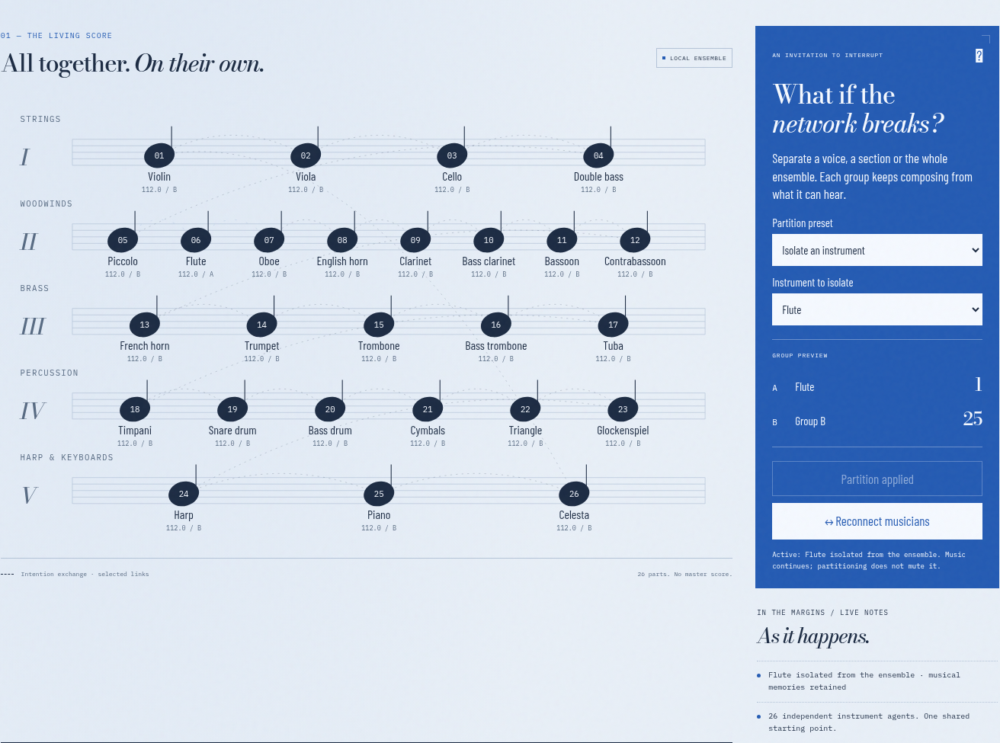
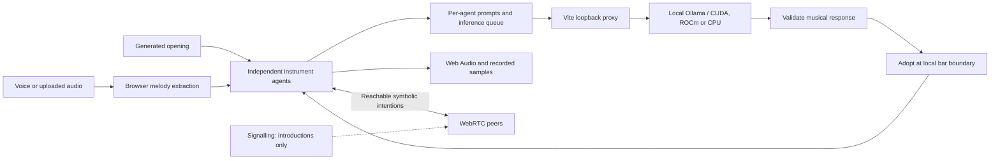

# Symphony Without a Conductor

**Twenty-six voices. Zero conductors.**

A browser orchestra in which every instrument has its own musical memory, rhythm, tempo and local AI decisions. Give it a generated phrase, upload a melody, or sing an opening motif. Listen as the players develop it, separate them into independent groups, then reconnect them and hear their ideas meet again.

Built with **React, TypeScript, Vite, Web Audio, WebRTC and Ollama**. Run the whole orchestra on one computer, or give each browser its own instrument. Local composition needs no cloud API key, and musical rules keep playback going without an LLM.



## Features at a glance

| Feature | What you can do |
| --- | --- |
| **26 autonomous musicians** | Hear strings, woodwinds, brass, percussion, harp and keyboards with independent roles, registers, phrases and memory. |
| **Recorded orchestral sound** | Play 389 bundled samples with stereo seating, short/sustained articulations, dynamic envelopes and a synthesizer fallback. Audition individual instruments before performing. |
| **Sing the starting motif** | Record your voice with a live waveform and timer; preview the extracted melody before applying it. |
| **Upload or generate an opening** | Drop a short audio clip or generate a new 4–8-note phrase. The orchestra establishes it for two bars before developing it. |
| **Melodies that develop** | Agents echo, oppose, support, contrast or develop nearby phrases; sequences, inversion, reversal, neighbour notes and repeat checks vary the contour. |
| **Changing rhythm and phrasing** | Mix short runs, held notes, dotted values, rests and per-note articulation. Held rhythms also evolve while inference is delayed or unavailable. |
| **Harmony and accompaniment** | Choose among 12 tonics and eight scales; hear chord progressions, bass roots/fifths, piano voice leading, seventh chords and phrase resolution. |
| **Musical forms** | Use ABA, ABB, pop sections, four classical-inspired movements, free development, or let each agent choose. Remembered themes return. |
| **Live partition experiments** | Isolate one instrument, separate a section, split by all five sections, make 26 soloists, or build a custom two-group split. Reconnect without resetting the music. |
| **Local AI with GPU support** | Ollama runs the default Qwen3 model locally. The launcher prefers NVIDIA CUDA when detected and preserves ROCm support and CPU fallback. |
| **A view into every agent** | Inspect listening partners, decisions, inference state, key, form, melody, note values, articulation and rests. Filter/mute players or sections and adjust volume. |
| **Multiple computers** | Exchange symbolic musical intentions over WebRTC; each browser plays and thinks locally. A small signalling server introduces the peers. |
| **Blue concert-programme UI** | Follow the live score, tempo/key indicators, section timeline and event journal, with responsive layouts and reduced-motion support. |

## Contents

- [Requirements](#requirements)
- [Quick start: run the whole application](#quick-start-run-the-whole-application)
- [WSL setup](#wsl-setup) · [Windows setup](#windows-setup) · [Linux setup](#linux-setup)
- [Your first performance](#your-first-performance)
- [Recorded instruments](#recorded-instrument-sounds) · [Opening motifs and voice recording](#choose-the-opening)
- [Forms and gestures](#movements-forms-and-gestures) · [Rhythm and phrasing](#note-lengths-and-phrasing) · [Keys and modulation](#keys-modes-and-modulation)
- [Local musical intelligence](#local-musical-intelligence) · [Harmonic accompaniment](#harmonic-accompaniment-and-responsive-rhythm)
- [Instrument roster](#one-agent-for-each-instrument) · [Partition experiments](#partition-experiments) · [Multiple computers](#multiple-computers)
- [GPU setup](#gpu-setup) · [Configuration](#configuration) · [Troubleshooting](#troubleshooting)
- [Development and checks](#development-and-checks) · [Architecture](#architecture) · [Limits and data handling](#limits-and-data-handling) · [Credits](#credits)

## Requirements

| Requirement | Details |
| --- | --- |
| Node.js and npm | Use **Node.js 22.12 or newer on a supported release**. The commands below install the latest Node 22; npm comes with Node. Node 22.22.0 was used for the local checks. |
| Git / repository files | Clone this repository, or use an existing checkout. Private repository access is required if the repository is not public. |
| Browser and audio output | A current browser with Web Audio and WebRTC. Chrome/Edge provide a straightforward starting point; supported audio codecs and recording formats depend on the browser. |
| Ollama | Required for LLM composition, installed separately from npm. Optional when using musical rules alone. |
| Model storage | The default [qwen3:1.7b download is approximately 1.4 GB](https://ollama.com/library/qwen3:1.7b), in addition to Ollama, dependencies and the bundled samples. Runtime memory requirements depend on concurrency and the model. |
| GPU | Optional. A supported NVIDIA or AMD GPU accelerates inference; CPU inference is possible but can be slower than the app's inference timeout. |
| Microphone | Optional, for voice motifs. Recording needs browser permission and localhost or HTTPS. |
| Internet | Needed to install dependencies/Ollama and download models. Local demo playback and inference can then run without a cloud service. Remote peer discovery may use an external STUN server. |

Python, Docker, a database and an API key are **not required to run the app**. Python is only used by the optional sound-bank rebuild script.

## Quick start: run the whole application

If `node`, `npm`, `git` or `ollama` is missing, first follow the setup for [WSL](#wsl-setup), [Windows](#windows-setup) or [Linux](#linux-setup).

From the repository root:

```sh
npm ci
```

`npm ci` installs the versions pinned in `package-lock.json`. It does **not** install Ollama or download an LLM.

Use separate terminals, all opened in the same project directory:

| Terminal | Command | Keep it open? |
| --- | --- | --- |
| 1 — local model server | `npm run llm:serve` | Yes, while using local AI. If a working Ollama service already owns port 11434, use it or stop it before starting this launcher. |
| 2 — initial download, then web app | Run `npm run llm:pull` once; after it finishes, run `npm run dev`. | Keep the Vite server running. |
| 3 — peer discovery, optional | `npm run signal` | Only needed for WebRTC peer mode. One shared signalling server is enough for a room. |

Open **http://localhost:5173**, or the local URL Vite prints if that port is occupied. Click **Start performance** and allow the sound bank to load. There is no separate REST backend to start: Vite serves the interface and proxies local inference, Ollama runs the model, and the optional signalling server introduces peers.

For playback **without Ollama**, run just `npm ci` and `npm run dev`, then turn off **Your session → Local LLM composition**. Select a preset form if you want a fixed structure; **Agent choice** waits for a model and otherwise develops freely. Voice recording, uploads, instrument samples, musical rules and partitions remain available.

**On subsequent runs:** start the model server and web app again; the model download is retained. Run `npm ci` again after dependency changes or when moving to a different operating-system environment. Stop foreground servers with **Ctrl+C**. Pause/resume preserves musical state; reloading the page starts a new session.

## WSL setup

Use **WSL 2**, with Node, npm, the project and Ollama all inside the same Linux distribution. Open the app in your normal **Windows browser** for sound and microphone access. Windows Terminal is suitable: choose its **Ubuntu/WSL profile** for the Linux commands, rather than a PowerShell tab. Keep the repository under the Linux home directory, such as `~/projects`, as recommended in [Microsoft's Node-on-WSL guide](https://learn.microsoft.com/en-us/windows/dev-environment/javascript/nodejs-on-wsl).

### 1. Install or check WSL

In **Windows PowerShell as Administrator**, install Ubuntu if you do not already have it:

```powershell
wsl --install -d Ubuntu
```

Restart Windows if requested, launch Ubuntu, and create your Linux username/password. Back in PowerShell, check/update WSL:

```powershell
wsl --update
wsl --list --verbose
```

The Ubuntu entry should show version `2`. If an existing distribution uses version 1, convert it with `wsl --set-version Ubuntu 2`, substituting its exact distribution name. See [Microsoft's WSL installation guide](https://learn.microsoft.com/en-us/windows/wsl/install).

### 2. Install Node and npm inside Ubuntu

Run these in the **Ubuntu/WSL terminal**. Skip the Node installation if your Linux `node --version` already meets the requirement.

```bash
sudo apt update
sudo apt install -y git curl ca-certificates zstd

export NVM_DIR="$HOME/.nvm"
curl -fsSL https://raw.githubusercontent.com/nvm-sh/nvm/v0.41.0/install.sh | bash
source "$NVM_DIR/nvm.sh"
nvm install 22
nvm alias default 22
nvm use 22

node --version
npm --version
```

This uses [nvm's official installer](https://github.com/nvm-sh/nvm#installing-and-updating). New Ubuntu terminals should load nvm automatically. Installing Node on Windows alone does not provide a Linux Node installation inside WSL.

### 3. Clone and install the application

In Ubuntu:

```bash
mkdir -p ~/projects
cd ~/projects
git clone https://github.com/fouroceans10/durhack2026.git
cd durhack2026
npm ci
```

If you already have the repository, `cd` into it instead of cloning again. Do not share `node_modules` between Windows and WSL; use a separate checkout or reinstall dependencies in the environment that will run the app.

### 4. Install Ollama in WSL

In Ubuntu, use the [official Linux installer](https://docs.ollama.com/linux):

```bash
curl -fsSL https://ollama.com/install.sh | sh
ollama --version
```

The installer may start an Ollama service. To use this project's launcher instead, check `systemctl is-active ollama`; **if it reports active**, stop that service first:

```bash
sudo systemctl stop ollama
```

If WSL is not running systemd, skip the service commands and use the foreground launcher. Keep only one Ollama server listening on port 11434. A Windows Ollama tray application is a different installation; the simplest WSL setup keeps Ollama inside Ubuntu too.

For **NVIDIA CUDA**, install/update the NVIDIA driver on **Windows**, update WSL, then run `nvidia-smi` inside Ubuntu. If the command is absent, try `/usr/lib/wsl/lib/nvidia-smi`; if that works, add `/usr/lib/wsl/lib` to the `PATH` of the terminal that launches Ollama. Do not install a Linux NVIDIA display driver inside WSL: WSL uses the Windows driver. See [NVIDIA's WSL guide](https://docs.nvidia.com/cuda/wsl-user-guide/index.html).

AMD support under WSL depends on the exact GPU, Windows driver, distribution and ROCm release. Check [AMD's WSL compatibility matrix](https://rocm.docs.amd.com/projects/radeon-ryzen/en/latest/docs/compatibility/compatibilityrad/wsl/wsl_compatibility.html) and [Ollama's hardware support](https://docs.ollama.com/gpu); native Linux ROCm support does not automatically imply support for the same card under WSL.

### 5. Run it

In Ubuntu terminal 1:

```bash
cd ~/projects/durhack2026
npm run llm:serve
```

In Ubuntu terminal 2, once Ollama is listening:

```bash
cd ~/projects/durhack2026
npm run llm:pull
npm run dev
```

For peer mode, run `npm run signal` in a third Ubuntu terminal in the repository. Open **http://localhost:5173 in Windows Chrome/Edge**, not the signalling or Ollama port. Windows can normally reach a WSL-hosted app through localhost; see [Microsoft's WSL networking guide](https://learn.microsoft.com/en-us/windows/wsl/networking). Microphone permission belongs to the Windows browser, so a Linux microphone device is not needed for this workflow.

## Windows setup

This path runs everything **natively on Windows**, using PowerShell. Keep the checkout on a Windows drive, separate from a WSL checkout.

### 1. Install the tools

Install the Windows versions of:

- [Node.js](https://nodejs.org/en/download): choose Node 22.12+ or a newer supported release, with npm included.
- [Git for Windows](https://git-scm.com/install/windows), if cloning with Git.
- [Ollama for Windows](https://ollama.com/download/windows), if using local AI.

Close and reopen PowerShell after installation, then check:

```powershell
node --version
npm.cmd --version
git --version
ollama --version
```

The examples use `npm.cmd` so PowerShell does not need to execute the `npm.ps1` wrapper. If `npm` already works, it is equivalent for these commands.

Ollama's Windows installer normally starts a background tray application. To use the project launcher below, **Quit Ollama from the system tray first**, freeing port 11434. Alternatively, keep that service and skip `llm:serve`; its existing GPU settings/model directory will apply. See [Ollama's Windows guide](https://docs.ollama.com/windows).

### 2. Clone and install

```powershell
cd "$env:USERPROFILE"
git clone https://github.com/fouroceans10/durhack2026.git
cd durhack2026
npm.cmd ci
```

Use your actual project directory if it is already checked out elsewhere. Keep fresh Windows dependencies and binaries; a Linux executable under `.local/ollama/bin/ollama` cannot run natively on Windows.

### 3. Start the servers

PowerShell terminal 1:

```powershell
cd "$env:USERPROFILE\durhack2026"
npm.cmd run llm:serve
```

PowerShell terminal 2:

```powershell
cd "$env:USERPROFILE\durhack2026"
npm.cmd run llm:pull
npm.cmd run dev
```

Optional terminal 3 for peer mode:

```powershell
cd "$env:USERPROFILE\durhack2026"
npm.cmd run signal
```

Open **http://localhost:5173** and start the performance. For NVIDIA, confirm `nvidia-smi` works in the same PowerShell environment; for AMD, use a GPU and driver supported by the installed Windows Ollama release. Verify actual inference with `npm.cmd run test:gpu` after the model download.

## Linux setup

The commands below target **Ubuntu/Debian with Bash**. On another distribution, install Git, curl, CA certificates and zstd with its package manager; the npm commands are the same.

### 1. Install Node and npm

Skip this installation if a supported Node/npm is already on your Linux `PATH`:

```bash
sudo apt update
sudo apt install -y git curl ca-certificates zstd

export NVM_DIR="$HOME/.nvm"
curl -fsSL https://raw.githubusercontent.com/nvm-sh/nvm/v0.41.0/install.sh | bash
source "$NVM_DIR/nvm.sh"
nvm install 22
nvm alias default 22
nvm use 22

node --version
npm --version
```

The version manager avoids relying on a distribution package that may contain an older Node release. See [nvm's installation instructions](https://github.com/nvm-sh/nvm#installing-and-updating).

### 2. Clone and install

```bash
mkdir -p ~/projects
cd ~/projects
git clone https://github.com/fouroceans10/durhack2026.git
cd durhack2026
npm ci
```

### 3. Install Ollama and check GPU support

```bash
curl -fsSL https://ollama.com/install.sh | sh
ollama --version
```

Use [Ollama's Linux guide](https://docs.ollama.com/linux) for manual installation or distribution-specific details. If its background service is active and you want the project launcher to manage the runtime, stop it with `sudo systemctl stop ollama` first. On a system without systemd, start the foreground launcher directly.

Install the appropriate **Linux GPU driver** for your hardware. For NVIDIA, `nvidia-smi` should show your GPU. For AMD, follow [Ollama's ROCm compatibility requirements](https://docs.ollama.com/gpu); a manual AMD installation also needs the matching ROCm archive alongside the base Ollama package. Use matching releases and the appropriate architecture. The project does not install GPU drivers or bundle runtime libraries.

### 4. Start the application

Terminal 1:

```bash
cd ~/projects/durhack2026
npm run llm:serve
```

Terminal 2:

```bash
cd ~/projects/durhack2026
npm run llm:pull
npm run dev
```

For peer mode, run `npm run signal` in a third project terminal. Open the Vite URL in your Linux browser. The browser owns audio output and microphone capture; the Node/Ollama processes do not need access to your microphone.

## Your first performance

1. **Choose a starting point.** Listen with **Hear random motif**, generate another, upload a short solo melody, or use **Record my voice**. After recording/uploading, preview the adapted notes and click **Use as opening**.
2. **Choose a musical setting while paused.** Set the home key, scale and modulation policy. Pick a form, bars per section and an optional gesture focus. A four-bar ABA section is useful for hearing a departure and return quickly.
3. **Start performance.** The sound bank loads first. Pitched players establish the opening for two bars, then begin responding independently. With AI enabled, responses arrive as model capacity becomes available.
4. **Inspect a musician.** In **The players**, expand its decision row to see who it hears, its current strategy, form, key, entrances and notation. Filter by section, mute voices or adjust master volume to hear the arrangement more clearly.
5. **Try an interruption.** Select **Isolate an instrument → Flute → Apply partition**. The flute still sounds, but no longer exchanges musical ideas with the other 25. Try a section split or custom group, then **Reconnect musicians**.
6. **Compare the approaches.** Turn **Local LLM composition** off to hear the deterministic rules. Turn it back on to resume model-driven responses; adjust **Re-evaluation interval** to change how often an accepted phrase becomes eligible for review.
7. **Pause or start fresh.** Pause/resume keeps the performance's memory. To replace the opening, pause and generate/apply a new motif; this resets the affected players. Reloading starts a fresh session.

| Change while playing | Pause first |
| --- | --- |
| Partitions/reconnection, master volume, player/section mutes, roster filter, LLM toggle, model selection, re-evaluation interval | Opening upload/recording/replacement, home key/mode/modulation, form/section length/gesture focus, instrument audition, demo/peer mode and local instrument selection |

To hear an isolated instrument **on its own through the speakers**, also mute the other instruments. Network isolation and muting are separate controls.

## Recorded instrument sounds

Playback uses a bundled **389-sample, 53.1 MiB sound bank**. Strings, winds and brass use [VSCO 2 Community Edition](https://versilian-studios.com/vsco-community/) recordings, including separate staccato/spiccato takes. Grand piano, concert harp, glockenspiel and most percussion come from [VCSL](https://github.com/sgossner/VCSL). English horn and celesta use [FluidR3 renders](https://github.com/gleitz/midi-js-soundfonts). In **The players → Listen closely**, select a voice and click **Hear instrument** to audition sustained and short notes while the orchestra is paused. Motif previews use the recorded harp.

The first performance loads and decodes the relevant samples before starting any agent clocks, with visible progress. Demo mode loads the full bank; peer mode loads only the local instrument. Files are served by this app from `public/samples`, with no third-party audio requests at runtime. Successful decodes are reused for subsequent auditions and pause/resume within the page. If some files fail, a voice uses its nearest available recording; if its entire patch is unavailable, the original synthesizer remains a fallback. The player reports affected voices; pause and resume retries failed files.

Pitch follows the agent's exact MIDI note using the nearest recorded anchor. Short articulations and brief ordinary notes use recorded short takes where available, alternating takes on repeated notes. Sustained strings/winds/brass have crossfaded body loops; envelopes follow each agent's duration, velocity and articulation, preserving written rests and short notes. Plucked and struck sounds keep their recorded decay, gated at the requested note end. Stereo seating, mute and master compression apply to both sample and fallback voices.

Three patches are approximations: **bass clarinet uses clarinet recordings, contrabassoon uses bassoon, and bass trombone uses tenor trombone**. Extreme notes outside a recording's range are pitch-shifted further. Legato overlaps sustained recordings; it is not a dedicated transition-sample library. This compact bank uses one selected dynamic layer per pitch/articulation, with velocity controlling gain.

VSCO/VCSL assets are CC0; the FluidR3 renders are distributed as CC BY 3.0 US. See [sound credits](public/samples/CREDITS.txt), the included license texts and [per-file provenance](public/samples/provenance.json). To rebuild the committed assets, run `python3 scripts/build-sample-bank.py` with NumPy and SciPy installed. It downloads pinned source revisions to ignored `.local/sample-sources`, then trims, level-matches, loops and packages the selection. Python is not needed to run the app.

## Choose the opening

Each page load prepares a fresh **random motif** for the orchestra: 4–8 scale degrees in the chosen home key with a new rhythm. Click **Hear random motif** to preview it, or **Generate a new motif** to choose another and reset the performance. The generator varies melodic direction, entrances, written lengths and articulation, keeps intervals small, and prevents an identical reroll. The first two notes are at most half a beat apart, with a connected first note; later notes can still leave breathing spaces. It runs locally without waiting for inference; the individual LLM agents take over after the two-bar opening.

**Pause / Resume performance** retains the current musical state. To begin a new performance with a different opening, pause and use **Generate a new motif**, then **Start performance**. In peer mode, generating a new motif resets only the selected local instrument.

### Start from your own audio

In **A phrase of your own**, choose or drop a short MP3, WAV, or another audio format supported by your browser. Clips must be 0.25–30 seconds and at most 15 MiB. A clear solo instrument, humming, or whistle works best; this is approximate melody extraction, not polyphonic transcription of a full mix.

To sing or hum directly, click **Record my voice**, allow microphone access, then click **Stop recording** when your phrase is finished. A live blue waveform follows the microphone signal as you sing, alongside an elapsed-time counter; recording stops automatically within 30 seconds. **Cancel recording** discards the take and keeps your previous motif. The microphone turns off when you stop, cancel, start the performance, or leave the component. Recordings use the same local extraction and preview as uploaded audio.

Microphone capture requires localhost or HTTPS and a browser with microphone recording support. With WSL, open the app at **http://localhost:5173 in your Windows browser** and grant that browser microphone permission. See [the browser microphone API](https://developer.mozilla.org/en-US/docs/Web/API/MediaDevices/getUserMedia) for permission requirements.

1. Listen to the original recording and click **Hear the motif** to preview the extracted phrase.
2. Click **Use as opening**, then **Start performance**. The pitched instruments play the phrase in their own registers for two bars; unpitched percussion keeps its own rhythmic pattern.
3. After the opening, the existing local LLM agents start developing it from the actual notes their neighbours play. If inference is unavailable, the rule-based fallback develops it instead.

The first 12 stable notes are reduced to a single 16-step bar at the starting tempo of 112 BPM. Entrances and detected note lengths are quantized, duplicate entrances removed, octaves folded, and chromatic notes fitted to the nearest note in the selected home key and mode. The original key is not inferred automatically; choose a home key before applying the phrase. Changing that selection remaps the preview from the original detected MIDI notes without decoding again. Original duration, key, articulation and octave contour are not reproduced exactly. The preview and displayed notes show the adapted phrase before you apply it.

Pause to replace or reapply a motif; doing so begins a fresh performance and clears the affected agents' previous phrases/history. **Generate a new motif** switches back from an uploaded phrase to a newly generated opening. In peer mode, an upload seeds only the selected local instrument; remote musicians learn about it through normal played-note messages.

Decoding uses the browser's [Web Audio API](https://developer.mozilla.org/en-US/docs/Web/API/BaseAudioContext/decodeAudioData); [Pitchy](https://github.com/ianprime0509/pitchy) detects stable pitches in a Web Worker. Analysis and previews stay in the browser, with cancellable work and no audio upload to a server. Audio files are not sent to Ollama. Only the resulting musical state enters the existing agent prompts. Clips and motifs are session-only and are cleared by a page reload.

## Movements, forms and gestures

The **A theme. A departure. A way home.** panel controls musical form, section length (4, 8, 16 or 32 bars), and gesture focus. Pause to change them. A change restarts the form from the current phrase; generating or uploading a new opening clears the remembered themes while retaining your form settings.

| Form | Route |
| --- | --- |
| Agent choice (default) | Each local model chooses ABA, ABB, pop or classical when it first composes; that choice stays fixed until the form or opening is reset. |
| ABA | Establish A, contrast with B, return to remembered A. |
| ABB | Establish A, contrast with B, repeat remembered B. |
| Pop | Intro → verse → chorus → verse → chorus → bridge → final chorus → outro. Repeated verses and choruses recall their respective themes. |
| Classical | I: Allegro, A/B exposition → development → A/B reprise; II: Adagio, ABA; III: Scherzo, ABA; IV: rondo finale, ABACA. |
| Free development | Continuous interaction without a fixed section route. |

Forms advance on **each musician's own step counter**, with no global conductor or model call controlling the ensemble. The main timeline follows the violin in demo mode and the local player in peer mode; each instrument's expanded decision row shows its own form, movement, section, gesture and theme action. Agent-selected forms may differ between players, and local clocks can drift. Presets give players the same route, not sample-accurate synchronization. Forms loop rather than ending the performance automatically.

Each agent keeps its own bounded theme library. On a section boundary, its remembered theme is introduced for one bar before new model decisions can replace it. A new contrasting theme is derived from that agent's opening when no theme has yet been remembered. Subsequent returns restore that theme. The model receives the section's intention, movement, current bar, cadence cue, remembered theme, and reachable neighbours' sections and actual played notes. It chooses whether to **develop, contrast or recall**, alongside its listening partner and musical strategy. Replies from an earlier section are discarded. Preset forms and remembered returns continue when inference is unavailable; Agent choice stays in free development until a model chooses a form.

Gestures affect actual synthesis: **arpeggios** break a triad into three timed notes; **mordents** play the main note, lower diatonic neighbour, then main note; **trills** alternate with the upper neighbour; **ostinatos** repeat a short cell; **legato/staccato** lengthen/shorten articulation. The model can choose freely, or you can select a gesture focus. Pitched ornaments are omitted for unpitched percussion. Sub-note offsets are recorded with performed notes so neighbouring agents can observe the ornamentation.

The classical preset changes target tempo, energy and default articulation across its four movements. It is a **classical-inspired arrangement**, not a complete sonata-form composition system: form-led modulation supplies related keys and a home-key recapitulation, but there is no pivot-chord planning or full harmonic analysis. All sections retain the 16-step 4/4 grid, including the scherzo. Pop forms likewise describe instrumental section roles rather than lyrics or vocals. See [Open Music Theory on formal sections](https://viva.pressbooks.pub/openmusictheory/chapter/formal-sections-in-general/) and [rondo form](https://viva.pressbooks.pub/openmusictheory/chapter/rondo/) for the distinctions behind these presets.

## Note lengths and phrasing

Agents choose **written duration and articulation for each entrance**, independently of melody and ornaments. The 4/4 bar supports semiquavers (¼ beat), quavers (½), crotchets (1), minims (2), semibreves (4), and dotted quavers/crotchets/minims. These values scale with each agent's tempo. A phrase can contain up to 16 entrances; shorter notes followed by a gap create actual rests. [Open Music Theory explains the note-value relationships](https://viva.pressbooks.pub/openmusictheory/chapter/notating-rhythm/).

The local model receives neighbours' sounding lengths and articulation, its recent choices, movement context, and rotating rhythmic suggestions. Suggestions exclude its current/recent patterns and vary by instrument and local bar; the model can choose, combine or invent an alternative. This helps the small model explore short runs, held responses, dotted rhythms and breathing spaces instead of copying an unchanging quaver stream. Theme recall preserves the remembered note lengths.

**Legato** holds through the next adjacent entrance with a small overlap; **staccato** sounds 40% of the written value; **tenuto** holds the full value; **accent** adds emphasis; ordinary articulation leaves a small separation. Written rests and bar boundaries are preserved. Each phrase can mix articulations, including within an arpeggio. Gesture focus **Legato/Staccato** overrides the individual articulations after the opening; other gestures allow mixed phrasing. Strings, winds and brass use recorded sustained and short articulations where available. Legato uses overlapping sustained samples. Plucked/percussive voices retain their natural recorded decay within the requested gate.

The **Shape of a bar** display and each instrument's expanded row show note symbols, British note names, counts, articulations and rests. Generated openings vary lengths and phrasing too; uploaded motifs estimate lengths from detected notes, without trying to infer the recording's articulation. Old peer messages without these fields remain playable using durations inferred from their entrances. Explicit tuplet notation, cross-bar ties and changing metre are not implemented.

## Keys, modes and modulation

**Choose a home. Let them wander.** selects any of the 12 tonics and major, natural minor, harmonic minor, Dorian, Phrygian, Lydian, Mixolydian or Locrian. Each page load chooses a shared random home key from major, minor, Dorian and Mixolydian. **Surprise key** changes it; generating a new motif keeps your selected key. Previews, note names, ornaments, synthesis and uploaded-motif adaptation all use that scale. Unpitched percussion keeps its timbre.

| Modulation | Behaviour |
| --- | --- |
| Stay in the home key | Every phrase uses the chosen tonic and scale. |
| Follow the form (default) | A is home; B visits the dominant in major or relative major in minor. Pop keeps verses/choruses home and moves its bridge to the relative key. Classical development visits the relative key, both reprise themes return home, Adagio uses the relative key and Scherzo the subdominant. The rondo alternates home with related-key episodes. Free development holds its key. |
| Let agents modulate | Each local LLM can stay, return home, or choose the home's dominant, subdominant, relative or parallel key. A change enters at a bar boundary, at most once per section (four bars in free development). Openings and returning sections are protected. Recalled themes restore the key saved on their first entrance. |

Degree motifs transpose into the current scale. For modal scales, the relative destination is their parent major; harmonic minor uses the natural minor's relative major. Dominant/subdominant destinations retain the home's mode. These are constrained tonal routes. Accompaniment adds chord progressions and piano voice leading, but does not perform full harmonic analysis. See [Open Music Theory on modes](https://viva.pressbooks.pub/openmusictheory/chapter/diatonic-modes/) and [closely related keys](https://viva.pressbooks.pub/openmusictheory/chapter/extended-tonicization-and-modulation-to-closely-related-keys/).

Each prompt includes its own home/current key, scale notes, permitted destinations and neighbours' actual MIDI pitches and keys. A neighbour playing outside the listener's scale is mapped to its nearest degree rather than ignored. The tonal-centre display reports mixed keys when appropriate; each instrument's expanded row shows its own key. Manual controls apply to all local demo players, or only the selected local instrument in peer mode. Pause to change them; this transposes the current phrase, clears stale inference and restarts theme memory. Remote peers keep their own settings.

## Local musical intelligence

Each instrument makes **its own Ollama request**. The default is `qwen3:1.7b`: one loaded model serves separate prompts and musical memories rather than producing a single global score. The browser sends symbolic note observations and musical context, not microphone audio.

The platform guides above install and start the runtime. In **Your session**, leave **Local LLM composition** enabled and use **Check local model** to confirm that the model is installed. To try another local model:

```sh
npm run llm:pull -- MODEL_NAME
```

Replace `MODEL_NAME` with an Ollama model tag, then click **Check local model** and select it. Cloud aliases and remotely hosted models are excluded. Small models may follow the musical schema less reliably; model size, speed and available memory affect how often the orchestra can accept new ideas.

### What each agent hears and decides

- Each musician records the actual note events sent to its synthesizer: MIDI pitch, onset, sounding duration, velocity, written note value and articulation. Ornament offsets describe their scheduled sub-notes. History is bounded to 24 events from the last two bars. Muted instruments do not contribute notes.
- The agent listens to at most six **reachable** neighbours, prioritising its own orchestral section and nearby stereo seating. “Nearby” means this virtual seating, not microphone or physical-location detection. Peer note metadata travels over WebRTC; audio remains local.
- Its prompt contains those observations, its instrument's role and register, its current phrase, structural context, remembered theme and last few accepted decisions. The model chooses a listening partner, response type (echo, counterpoint, support, contrast or development), interval, entrances, per-note written durations and articulations, energy, form, gesture, theme action and an allowed key change. A deterministic realization grounds new phrases in the selected partner's recent notes; a theme recall restores its saved motif, rhythm and note values, including short uploaded motifs. Unpitched percussion contributes rhythm/dynamics rather than fictitious pitches.
- [Structured output](https://docs.ollama.com/capabilities/structured-outputs) is validated: notes stay in the agent's current scale and instrument register, rhythm stays within the bar, and decisions cannot reference unheard players. Repeated rhythmic entrances are deduplicated together with their attached durations/articulations. Arrays must have one entry per onset. Notes that exceed the next onset or bar line shorten to the largest supported value that fits. The model also chooses a melodic transformation: keep the contour, develop a short cell as a sequence, invert it, reverse it, or add neighbouring-note turns. A repeat check compares the first bar’s audible pitches with the current motif and three recent decisions; near-repeats receive a related contour variation instead of changing only a potentially unplayed final note. Free development and new sections develop or contrast their material; exact theme recall remains available on structured returns. All variations stay within the selected scale and instrument register. Repeated rhythms are checked against current and recent entrances: the engine splits held notes, merges pairs, or displaces entrances with breathing spaces while keeping durations and articulation aligned. Responses are data, never executed code.
- Each agent's accepted phrase enters at its **next local bar boundary**. The audio scheduler never waits for inference. A fair queue runs up to four independent requests concurrently and serves the least recently reviewed agent first. Agents become eligible again **2 seconds** after adopting a phrase, checked every 200 ms. The **Re-evaluation interval** control offers 1, 2, 4, 8 or 12 seconds and can change during playback without clearing history. This is a minimum wait: model inference, the shared queue and the next bar add latency, so 26 agents do not each update every two seconds. One-instrument-per-laptop mode distributes that work.
- A request times out after 20 seconds. Replies based on observations more than four local bars old are discarded and immediately become eligible for a fresh attempt. Section changes also invalidate stale context. Malformed musical replies back off only their own agent; network/runtime errors and timeouts also pause the shared queue briefly. Failure backoff remains in place when the re-evaluation interval changes. The last accepted pitches keep playing. After two complete bars without a new decision, the engine varies the held rhythm at a bar boundary; ostinato hooks get four bars. This also works with inference disabled or unavailable. Openings, section entrances and explicit theme recalls retain their timing. Agents without a model phrase also use deterministic pitch rules that react to heard notes. The UI distinguishes thinking, ready, playing and inference-unavailable states.

Partitioning cancels pending and in-flight decisions, preserves each agent's musical memory, and restricts subsequent context to the remaining reachable group. Reconnection starts fresh listening; a model does not receive hidden information from an isolated group.

### Harmonic accompaniment and responsive rhythm

Accompaniment follows repeating, mode-specific four-bar chord progressions. Structured sections approach their ending through a dominant chord and resolve to the tonic; the middle of a phrase can introduce a diatonic seventh. Each musician computes this from its own key, form and bar position. Musicians with matching clocks/forms therefore share a progression without a central conductor; independent forms or drifting clocks can still produce different chords.

Low pitched instruments anchor chord roots and fifths. Piano plays the current chord with an inversion chosen to reduce movement from its actual previous notes, including across key changes. Melodic voices retain their chosen contours. The two-bar recorded/random opening, the first bar of a section and explicit theme recalls bypass this accompaniment treatment to preserve the original phrase. Model-written onsets, rests, durations and articulation remain intact. Local-model prompts include the chord tones, tension and audible percussion energy so musical choices can take the accompaniment into account.

Without an accepted model phrase, rhythms develop every two bars (four for ostinatos): energetic reachable percussion encourages syncopated bass/keyboard parts and busier melodic replies, while no drums permits more lyrical spacing. Kick/snare anchors remain recognizable, and snare ghost notes play more softly than the backbeat. Muted or stale voices do not contribute rhythmic drive or energy. Solo melodic agents also develop their own contour every two bars, so fallback playback does not depend on another player or a running model. Pitch and rhythm updates enter before the first note of the new bar. An already accepted model melody remains intact while its held rhythm develops through the existing variation rules.

Vite development and preview servers proxy only `/api/local-llm/chat` and `/api/local-llm/tags` to Ollama on this computer. `SYMPHONY_OLLAMA_URL` can change the loopback port. In peer mode, **run Ollama and the app server on each laptop** and open that laptop's localhost URL, then share only the signalling URL/room. Serving one app instance to every laptop would share that server's inference runtime instead.

## One agent for each instrument

| Section | Agents |
| --- | --- |
| Strings (4) | Violin, viola, cello, double bass |
| Woodwinds (8) | Piccolo, flute, oboe, English horn, clarinet, bass clarinet, bassoon, contrabassoon |
| Brass (5) | French horn, trumpet, trombone, bass trombone, tuba |
| Percussion (6) | Timpani, snare drum, bass drum, cymbals, triangle, glockenspiel |
| Harp & keyboards (3) | Harp, piano, celesta |

An agent represents an instrument type, rather than every individual player in a symphony orchestra. Each has its own ID, tempo, energy, motif, step counter and partition membership. Instrument profiles define distinct registers, rhythmic entrances, articulation, voice and stereo position. Each agent's local model chooses its melodic response to what reachable neighbours have played; deterministic rules handle timing and fallback. Voices use the recorded sound bank described above, with oscillator/noise synthesis only as a fallback when samples are unavailable. A master compressor controls ensemble peaks.

## Partition experiments

Use **What if the network breaks? → Partition preset** to preview a split, then **Apply partition**. You can change it during playback with **Update partition**, or restore communication with **Reconnect musicians**:

- **Two mixed groups:** the original 13/13 split, with every section represented in both groups.
- **Isolate an instrument:** choose any of the 26 voices; it develops alone while the other 25 keep communicating.
- **Separate one section:** put strings, woodwinds, brass, percussion or harp/keyboards in their own group.
- **Each section on its own:** five independent groups.
- **Every instrument on its own:** 26 solo agents with no shared musical ideas.
- **Choose two groups:** check instruments for group A; the remaining instruments form group B. Both groups must contain at least one instrument.

Partitioning changes communication, not volume: every musician keeps its phrase, tempo, clock and memory. The same group rules filter both the deterministic music engine and local-model observations. Applying or replacing a partition cancels pending inference and removes cached peer observations. Reconnection exposes fresh note histories so agents can answer each other's developments while tempo gradually converges. The map and player labels show the applied groups; the controls can preview a different split without applying it. The map draws selected links for readability; each musical prompt uses the closest six audible, reachable neighbours.

## Multiple computers

For a first peer-mode test, run one signalling server and open two browser tabs at localhost. In each tab, select **Your session → Mode → WebRTC peer orchestra**, choose a different instrument, enter the same room and `ws://localhost:8787`, then **Join room** and **Start performance**. Each tab plays only its local instrument. Two tabs on one computer share that computer's Ollama runtime.

For multiple laptops:

1. Install/run the app and Ollama on **each** laptop and download its local model. Open that laptop's own localhost app URL.
2. Start **one** reachable signalling server for the group. Use its address in every browser; `localhost` in each browser refers to that laptop, not to the host of the shared room.
3. Choose an instrument per browser, enter the same room, join and start playing. Each instrument's audio comes from its own device; hearing the full ensemble requires listening to those outputs together.
4. Apply matching partitions on all participating browsers for a room-wide split. A partition changed on one browser affects only links to that browser.

On a trusted LAN, an HTTP localhost app can use a reachable `ws://SIGNALLING_HOST:8787`; substitute the actual host address. For an HTTPS-served app, use `wss://`. WSL-hosted signalling may require additional LAN routing/firewall configuration; Windows localhost forwarding alone is not a multi-laptop hosting setup. See [Microsoft's WSL networking guide](https://learn.microsoft.com/en-us/windows/wsl/networking).

This mode runs **one local instrument agent per browser**; recently heard remote agents appear in the map and roster. Use HTTPS for an app served from a non-localhost address, and a WSS reverse proxy for remote signalling. Remote audio plays on its originating device.

Existing data channels survive signalling-server shutdown. In peer mode, **Isolate this browser** blocks all musical exchanges with the local player. The other presets selectively allow only peers whose instruments share its group. These are **local connection controls**: they do not change communication between other browsers. Apply the same preset on every browser to create a matching room-wide split. Incoming and outgoing intentions are both filtered, while an instrument-identity handshake continues so peers can discover their roles even when joining with a partition already active. Musical notes, tempo and memory are not included in that handshake. Changing the partition immediately clears local cached observations; other devices' old observations expire after four seconds. Audio keeps running locally. Switching between demo and peer mode restores connectivity and resets the partition controls. Rooms are ephemeral and support up to 64 peers, enough for all 26 instruments. The signalling server only introduces peers and relays WebRTC negotiation, with no musical authority. This prototype has no room authentication: use a trusted demo network.

A public STUN server assists discovery; restrictive NATs need a TURN service configured in `src/network.ts`. Keep tabs foregrounded: browser background throttling can interrupt scheduling. No audio is transmitted. Full-mesh networking has quadratic connection growth, so the room limit is not a claim of tested 64-device performance.

## GPU setup

GPU selection belongs to the **Ollama server**, not the browser's graphics settings. Starting `npm run llm:serve` applies the project's detection policy:

| Situation | Launcher behaviour |
| --- | --- |
| NVIDIA detected by `nvidia-smi` on Linux/WSL or Windows | Prefer CUDA by hiding competing ROCm devices and disabling Vulkan for this process. Ollama selects its compatible CUDA backend and layer allocation. |
| No NVIDIA detected, or the probe fails | Preserve Ollama's normal detection, including supported AMD ROCm and CPU fallback. |
| GPU-selection environment variables already set | Respect the explicit selection, even an empty value. Do not override it. |
| Ollama was already running elsewhere | Its startup environment wins; running `llm:pull` or `llm:status` cannot reconfigure it. |

Supported GPUs, driver versions and backends vary by platform/release. Consult [Ollama's hardware list](https://docs.ollama.com/gpu), the [Windows guide](https://docs.ollama.com/windows) or the [Linux guide](https://docs.ollama.com/linux). AMD users should retain the matching ROCm backend; NVIDIA detection does not remove any installed AMD support. WSL uses Windows GPU drivers as described in [WSL setup](#wsl-setup).

### Verify actual offloading

With Ollama running and `qwen3:1.7b` downloaded:

```sh
npm run test:gpu
npm run llm:status
```

`test:gpu` makes a real musical decision, checks that it changes playable notes, and reports generation speed, GPU memory and resident percentage. It fails on CPU-only inference. Partial GPU offloading passes but reports less than 100%. An empty `llm:status` table simply means no model is currently loaded; start a performance or run the integration check first.

Local development checks have exercised both NVIDIA CUDA under WSL and AMD ROCm on native Linux, including full GPU residency with the default model. These observations are hardware-specific, not a guarantee for every driver/GPU. The native Windows instructions follow the supported tooling path; they have not been end-to-end tested in this Linux workspace.

### Explicit GPU selection

For example, to hide NVIDIA and allow an installed AMD backend to be considered on a mixed-GPU machine, set this **before starting a new Ollama server**:

Linux/WSL:

```bash
CUDA_VISIBLE_DEVICES=-1 npm run llm:serve
```

Windows PowerShell:

```powershell
$env:CUDA_VISIBLE_DEVICES = "-1"
npm.cmd run llm:serve
```

After stopping that PowerShell-launched server, remove the setting with `Remove-Item Env:CUDA_VISIBLE_DEVICES` to restore automatic selection for future launches. This example hides NVIDIA; it does not force ROCm when no compatible AMD runtime is installed. The launcher also respects `HIP_VISIBLE_DEVICES`, `ROCR_VISIBLE_DEVICES`, `GPU_DEVICE_ORDINAL`, `OLLAMA_LLM_LIBRARY`, `OLLAMA_VULKAN` and `GGML_VK_VISIBLE_DEVICES`.

### Memory and concurrency

The app queues at most **four concurrent agent requests**, and the bundled launcher defaults Ollama to `OLLAMA_NUM_PARALLEL=4`. Parallel contexts consume more memory. If the runtime runs out of memory, try a smaller model or a lower runtime parallelism value, then restart it:

```bash
OLLAMA_NUM_PARALLEL=1 npm run llm:serve
```

```powershell
$env:OLLAMA_NUM_PARALLEL = "1"
npm.cmd run llm:serve
```

This changes runtime capacity, not the browser's four-request queue. The UI's **Re-evaluation interval** controls the wait after adopting a phrase; it is not an inference timeout or a promise that all 26 agents update that often. [Ollama's FAQ covers runtime settings and concurrency](https://docs.ollama.com/faq).

## Configuration

### Services, addresses and model storage

| Setting | Default and scope |
| --- | --- |
| Vite development server | `npm run dev`, normally `http://localhost:5173`; the script listens on all interfaces. Vite prints the actual port. |
| Built-app preview | `npm run preview`, normally `http://localhost:4173`; also includes the local inference proxy. |
| Ollama | Launcher binds `127.0.0.1:11434` and sets `OLLAMA_NO_CLOUD=1`. Only local models are offered by the UI. |
| Model directory | A server started by the launcher uses `.local/models`, unless `OLLAMA_MODELS` is already set. An existing service keeps its own directory/settings. |
| Workspace-local executable | `.local/ollama/bin/ollama`, if present; otherwise the launcher resolves `ollama` from `PATH`. Neither runtime binaries nor downloaded models are committed. |
| Ollama parallelism | `OLLAMA_NUM_PARALLEL`, default `4` for the launcher. |
| Proxy destination | `SYMPHONY_OLLAMA_URL`, default `http://127.0.0.1:11434`; restricted to loopback hosts. Set it in the environment **before starting Vite/preview**. |
| Signalling | `npm run signal`, port `8787` by default; override with `PORT`. The UI starts with `ws://<page-hostname>:8787` or `wss://` on HTTPS. |
| Room | Default `durhack`; 1–48 letters, numbers or hyphens. Up to 64 peers per room. |

The model directory is controlled by the **running server**. If an ordinary Ollama service already owns port 11434, `npm run llm:pull` downloads into that service's model store, not automatically into the project's `.local/models`. Pick one runtime/store to avoid accidentally downloading the same model twice.

The launcher intentionally fixes Ollama to port 11434. To use a different port, start/manage Ollama separately and point Vite at it. The optional real-model check scripts currently target `127.0.0.1:11434` and `qwen3:1.7b` directly; changing the proxy URL or UI model does not reconfigure those scripts.

### Common overrides

Run the web app on another port:

```sh
npm run dev -- --port 5174
```

Use a signalling server on another port, then update the UI's **Signalling URL** to match:

```bash
PORT=8788 npm run signal
```

```powershell
$env:PORT = "8788"
npm.cmd run signal
```

Point the web app at a separately managed Ollama on loopback port 11435:

```bash
SYMPHONY_OLLAMA_URL=http://127.0.0.1:11435 npm run dev
```

```powershell
$env:SYMPHONY_OLLAMA_URL = "http://127.0.0.1:11435"
npm.cmd run dev
```

These are shell environment settings. No `.env` file is required, and the launcher does not load one. Keep model data, local tooling and generated development artifacts under the ignored `.local/` directory if you want them outside Git.

## Troubleshooting

| Symptom | What to check |
| --- | --- |
| `npm: command not found` / npm not recognised | Install Node **in the terminal environment you are using**. In WSL, install Linux Node with nvm, then `source ~/.nvm/nvm.sh` and `nvm use 22`. In Windows, reopen PowerShell after installing Node. Check `node --version` and `npm --version` (or `npm.cmd --version`). |
| `npm.ps1 cannot be loaded` in PowerShell | Use `npm.cmd` in place of `npm`; no execution-policy change is needed for that wrapper. |
| `ollama: command not found` / `Cannot launch Ollama: spawn ollama ENOENT` | Install Ollama separately using the relevant platform guide, reopen the terminal and check `ollama --version`. `npm ci` does not install it. |
| Node engine/version error or missing native Vite/Rolldown module | Use a supported Node release. If you moved between Windows and WSL/Linux, rerun `npm ci` in that environment to replace platform-specific dependencies. |
| Missing `package.json` / `ENOENT` when running npm | Run commands from the directory containing this repository's `package.json`. Every new terminal needs to `cd` there. |
| Port `11434` already in use | An Ollama service or Windows tray app is probably already running. Use it, or stop/quit it before launching another server. Do not run both against the same port. |
| Local model offline / inference proxy errors | Keep Ollama running and ensure Vite and Ollama use the same OS environment. The proxy is loopback-only. The WSL guide deliberately runs both in Ubuntu. |
| Ollama installed but model missing | With the intended server running, execute `npm run llm:pull`, wait for it to finish, then click **Check local model**. Model stores differ between Windows, WSL, project launchers and services. |
| GPU detected but inference still uses CPU | Check the driver/runtime and `nvidia-smi` where applicable, then run `npm run test:gpu`. Detection is only a preference; it does not install CUDA/ROCm or prove offloading. Restart the actual server after changing GPU settings. |
| Inference unavailable / repeated timeouts | The app keeps playing its rules/last accepted phrase. Check GPU offloading, model size, memory and other Ollama clients. Longer re-evaluation intervals reduce demand; smaller models may be faster. |
| Nothing happens immediately after Start | The first start loads/decodes the sample bank before starting clocks. Watch the loading percentage. Affected patches fall back to available recordings or synthesis. |
| No sound | Click Start to unlock browser audio; check master volume, browser/site audio, OS output device and player/section mutes. To test a patch, pause and use **Hear instrument**. |
| Cannot record / microphone permission denied | Use localhost or HTTPS, allow the site in browser permissions and enable microphone access for your browser in OS settings. In WSL, use the Windows browser. A plain LAN-IP HTTP URL may not be a secure context. |
| Flat live waveform or no notes extracted | Check the selected/default microphone and input level. Try a short, clear hum/whistle or solo instrument. Silence, speech-heavy audio and dense mixes may not yield a reliable motif. |
| Upload rejected | Use a browser-decodable audio clip of 0.25–30 seconds and at most 15 MiB. Re-export as WAV/MP3 if decoding fails. |
| Melody/rhythm seems held | The opening lasts two bars, section entrances get one bar, and explicit theme recalls preserve their material. New model phrases wait for bar boundaries and inference capacity. Inspect the agent row and try free development to compare. |
| Isolated instrument is still audible | Expected: partitioning blocks musical communication. Use mute controls separately to change what comes through the speakers. |
| Partition preview differs from the score | The preview is a draft until you click **Apply partition** or **Update partition**. The score and active status show the applied split. |
| Peer not visible or not responding | Check room, signalling URL, each player's Start button and partition settings. The UI shows recently received musical state; blocked devices or devices that are not broadcasting may not appear. Remote state expires after four seconds. |
| Peers cannot connect across networks | HTTPS pages need a WSS signalling endpoint. Check firewall/routing; restrictive NATs need TURN, which is not bundled. In WSL, localhost forwarding to Windows does not automatically expose a service to other laptops. |
| WSL app does not open in Windows | Use Vite's printed local port, confirm the server is running, and consult [Microsoft's WSL networking guide](https://learn.microsoft.com/en-us/windows/wsl/networking), including VPN/firewall and localhost-forwarding behaviour. |
| Static deployment loads but AI fails | The app needs the `/api/local-llm/chat` and `/api/local-llm/tags` proxy. Use `npm run preview` locally or provide an equivalent local proxy; static files alone cannot serve those routes. |

Useful diagnostic commands from the project terminal:

```sh
node --version
npm --version
ollama --version
npm run llm:status
```

Check whether the intended Ollama server lists the model:

```bash
curl http://127.0.0.1:11434/api/tags
```

```powershell
Invoke-RestMethod http://127.0.0.1:11434/api/tags
```

For microphone prerequisites, see [MDN's getUserMedia documentation](https://developer.mozilla.org/en-US/docs/Web/API/MediaDevices/getUserMedia). For service configuration and logs, see [Ollama's Linux guide](https://docs.ollama.com/linux) or [Windows guide](https://docs.ollama.com/windows).

## Development and checks

All npm commands below run from the repository root. On PowerShell, use `npm.cmd` if needed.

| Command | Purpose |
| --- | --- |
| `npm ci` | Install exact locked dependencies for a clean checkout. |
| `npm run dev` | Run the Vite development server and local inference proxy. |
| `npm run signal` | Run the WebSocket signalling server. |
| `npm run llm:serve` | Launch the local Ollama runtime with project defaults and GPU detection. |
| `npm run llm:pull` | Download the default local model into the running server's store. |
| `npm run llm:pull -- MODEL_NAME` | Download a different local model. |
| `npm run llm:status` | Inspect loaded models and CPU/GPU allocation. |
| `npm test` | Run the automated TypeScript/Node suite; no browser, Ollama or GPU required. |
| `npm run build` | Type-check and produce `dist/`. |
| `npm run preview` | Serve a built app locally, normally on port 4173, with the inference proxy. |
| `npm run test:llm` | Real default-model response, musical validation and played-note sensitivity. |
| `npm run test:gpu` | Same integration check, requiring GPU offloading. |
| `npm run test:forms` | Real-model decisions for ABA, pop, classical and agent-selected forms. |
| `npm run test:tonality` | Real-model decisions in non-C keys and constrained modulation. |
| `npm run test:phrasing` | Repeated real decisions with varying melody, rhythms, note values and articulation. |
| `npm run test:throughput` | Time a complete 26-agent pass with four concurrent client requests. |
| `npm run test:throughput -- 1` | Compare a serial client pass; the runtime's own settings still apply. |

The real-model checks require Ollama on **127.0.0.1:11434** with **qwen3:1.7b** installed. They make actual inference requests and can take longer than the unit suite. Their results depend on the machine and model responses; they are not guarantees of per-agent update latency.

The automated suite covers instruments and valid pitch ranges across all 96 key/mode combinations; melody and rhythm variation; note values, articulation and rests; forms, cadences and theme memory; harmony/voice leading; actual PCM motif extraction; recorder permissions/cancellation/cleanup; inference fairness and stale-response handling; GPU detection; all partition presets; incoming/outgoing peer filters and identity discovery; and signalling-room capacity. Browser checks during development have also exercised live recording waveforms, playback during partition changes, responsive controls and three-browser WebRTC partition/reconnect scenarios.

For a local production-build check:

```sh
npm run build
npm run preview
```

Keep Ollama running if using AI. A public deployment additionally needs appropriate hosting/TLS and the inference proxy; deploy signalling separately behind WSS for remote rooms. A shared app server would also share its Ollama runtime between clients, so distributed local inference requires the per-device setup described above.

## Architecture



- `src/orchestra.ts`: instrument catalog and section metadata; the roster, selectors, validation and agents derive from this catalog.
- `src/engine.ts`: performed-note history, bar-boundary plan adoption, fallback state evolution, note composition and audio routing.
- `src/sample-bank.ts`, `src/sample-manifest.json`: bounded sample loading, decode cache, pitch/articulation selection and recorded playback; `src/InstrumentAudition.tsx` previews individual voices.
- `public/samples/`, `scripts/build-sample-bank.py`: bundled recordings, credits, provenance and reproducible asset preparation.
- `src/local-llm.ts`: neighbour selection, per-instrument prompts/memory, Ollama adapter, bounded inference queue, cancellation and retry.
- `src/melody.ts`: shared musical-decision schema and validation.
- `src/StartingMotif.tsx`: audio upload, recording controls, adapted phrase preview and opening controls.
- `src/motif-recording.ts`, `src/RecordingWaveform.tsx`: microphone capture, bounded recording lifecycle and live signal visualization.
- `src/melodic-variation.ts`: bounded contour transformations and repeat avoidance.
- `src/phrasing.ts`, `src/PhraseNotation.tsx`: written note values, articulation, rhythmic suggestions, event normalization and live phrasing notation.
- `src/random-motif.ts`: bounded random melody/rhythm generation, shared as the initial idea before independent agent evolution.
- `src/tonality.ts`, `src/TonalityControls.tsx`: scales, note spelling, related keys, modulation policy and tonal controls.
- `src/harmonic-motion.ts`, `src/ensemble-rhythm.ts`: mode-specific chord progressions, piano voice leading and percussion-responsive fallback phrasing.
- `src/forms.ts`, `src/FormControls.tsx`: musical routes, movement/section context, bounded per-agent theme state, controls and local timeline.
- `src/motif-upload.ts`, `src/motif.worker.ts`, `src/motif-extraction.ts`: bounded audio decoding, worker lifecycle, pitch segmentation and starting-phrase extraction.
- `scripts/local-llm.mjs`: local runtime/model launcher; `vite.config.ts` supplies the loopback-only inference proxy.
- `src/main.tsx`: local look-ahead scheduling, section controls, notation-style orchestra map, partition demo and peer session UI.
- `src/style.css`: concert-programme visual design with paper grain, blue accents, staggered entrance motion and reduced-motion support.
- `public/fonts/`: locally bundled Bodoni Moda, Barlow Condensed and IBM Plex Mono with their OFL licenses; no runtime font service is required.
- `src/network.ts`: validated intention messages over WebRTC DataChannels, sent four times per second.
- `src/partitions.ts`, `src/PartitionControls.tsx`: shared communication rules, preset/custom group previews and live partition controls.
- `server/signalling.mjs`: room discovery and connection negotiation, with room capacity for the orchestra.

## Limits and data handling

- **Independent clocks:** tempos converge, but phase/clock-offset synchronization is not implemented. Start devices together for demonstrations. Agent-selected forms and keys can differ, so temporary harmonic disagreement is possible.
- **A constrained musical vocabulary:** all phrases use a 16-step 4/4 grid. There are no changing metres, explicit tuplets, cross-bar ties or complete harmonic-analysis/pivot-chord planning. Piano voice leading and chord progressions are present; the system is not a full composition/arrangement engine.
- **Approximate motif extraction:** the opening is reduced to scale degrees, quantized timing and at most 12 notes. Polyphonic transcription, exact octave contour and automatic source-key detection are not implemented. The user chooses the home key.
- **Local audio:** uploaded clips and microphone recordings are decoded/analyzed in the browser. Ollama receives musical data, not audio. WebRTC sends validated symbolic musical state, never the audio stream; each device plays its own instrument.
- **Local model inference:** the UI excludes cloud models, and the bundled server launcher disables Ollama's cloud features. Models are not trained or fine-tuned by this application. An independently managed Ollama service keeps its own configuration.
- **Session-only performance:** motifs, recordings, agent histories and room membership are not saved as projects. Reloading clears browser session state. There is no built-in MIDI export, full-performance recording or session-file export. Downloaded models remain on disk.
- **Networking scope:** signalling introduces peers without choosing music. Rooms have no authentication and are intended for a trusted demo network. Public STUN assists discovery; TURN is not configured. The 64-peer room limit is not a claim of tested 64-device performance.
- **Runtime files:** `.local/`, `node_modules/`, `dist/` and `.env*` are ignored by Git. A fresh clone does not contain another developer's Ollama installation, cached models or GPU-specific library fixes.

## Credits

The orchestral recordings come from **VSCO 2 Community Edition**, **VCSL** and **FluidR3 renders**. VSCO/VCSL assets are CC0; the included FluidR3 renders use CC BY 3.0 US. See [sound credits](public/samples/CREDITS.txt), the license files in `public/samples/`, and [per-file provenance](public/samples/provenance.json) for attribution and source details.

The interface uses locally bundled **Bodoni Moda**, **Barlow Condensed** and **IBM Plex Mono**, with their included OFL license texts. Melody extraction uses [Pitchy](https://github.com/ianprime0509/pitchy). Local inference uses [Ollama](https://ollama.com/) and the selected model under their respective licenses.

The chord-progressions, instrumental-role and percussion-responsive ideas were adapted from the project's `tarik` branch (`67f97ed`) while retaining this application's 26-agent architecture, recorded instruments and motif controls.
